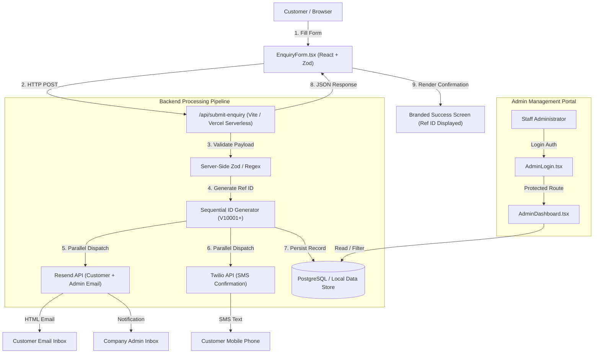

# VENUS Water Management – Technical Stack, Architecture & API Documentation

**Project Name:** VENUS – Water Management Solutions  
**Document Version:** 1.0.0  
**Classification:** Technical Assessment & Architecture Specification  
**Author:** Engineering Team  

---

## 1. Executive Summary

VENUS is an enterprise-grade, full-stack web application designed for a specialized industrial and commercial water management company. The platform provides public-facing product and solution showcases, an automated customer enquiry handling pipeline, real-time dual-channel notifications (Email & SMS), and a secure administrative console with persistent record tracking and analytical filtering.

This document details:
1. **The complete technology stack** (languages, frameworks, libraries, tools).
2. **How the system was built** (architecture, design patterns, state management, security model).
3. **All APIs used** (external third-party REST APIs, internal serverless endpoints, and browser Web APIs).

---

## 2. Technology Stack Breakdown

```
+-----------------------------------------------------------------------------------+
|                                 APPLICATION STACK                                 |
+-----------------------------------------------------------------------------------+
|  FRONTEND LAYER       | React 19, TypeScript 7, Vite 8, Tailwind CSS v4, Lucide   |
|  ROUTING & FORMS      | React Router v7, React Hook Form v7, Zod v4               |
|  BACKEND & MIDDLEWARE | Node.js ESM, Vite Dev Middleware, Vercel Serverless (ESM) |
|  DATABASE & SECURITY  | PostgreSQL 15+ (Supabase), Row Level Security, SHA-256    |
|  NOTIFICATIONS        | Resend REST API (Email), Twilio Messages API (SMS)        |
|  QUALITY & TESTING    | Node Test Runner, 41-Point Verification Suite, Oxlint     |
|  HOSTING & CLOUD      | Vercel Cloud Platform, GitHub (Protected Branch CI/CD)    |
+-----------------------------------------------------------------------------------+
```

### 2.1 Frontend Technologies

| Technology | Version | Purpose in Project |
| :--- | :--- | :--- |
| **React** | `v19.3.1` | Declarative, component-based user interface; leverages concurrent rendering features and optimized reconciliation. |
| **TypeScript** | `~7.0.2` | Strong static typing across components, form schemas, API contracts, and server handlers; prevents runtime type errors. |
| **Vite** | `v8.3.6` | Next-generation frontend build tool and dev server featuring instant Hot Module Replacement (HMR) and optimized Rollup asset bundling. |
| **Tailwind CSS** | `v4.3.5` | Modern utility-first CSS framework integrated via `@tailwindcss/vite`; utilizes CSS theme variables, fluid typography, and custom brand color palettes (`#102B46`, `#0284C7`, `#38BDF8`). |
| **React Router** | `v7.18.6` | Declarative client-side routing, nested layouts (`RootLayout`), dynamic active link states, and protected route wrappers (`AdminDashboard`). |
| **React Hook Form** | `v7.92.0` | Performant, uncontrolled form state management; minimizes unnecessary re-renders during user input. |
| **Zod** | `v4.6.7` | TypeScript-first schema declaration and runtime data validation; handles client and server validation for name, email, phone, and enquiry message. |
| **Lucide React** | `v1.75.0` | Accessible, tree-shakeable SVG icons for navigation, status badges, metrics, and actionable controls. |

### 2.2 Backend & Serverless Runtime

| Technology | Runtime | Purpose in Project |
| :--- | :--- | :--- |
| **Vite Dev Middleware** | Node.js ESM | Custom middleware plugin (`enquiryBackendPlugin` in `vite.config.ts`) that intercepts `/api/submit-enquiry` and `/api/enquiries` locally, enabling full-stack operation without running separate servers. |
| **Vercel Serverless Functions** | Node.js 18/20/22+ | Production serverless functions (`api/submit-enquiry.js`, `api/enquiries.js`) written as standalone native ESM modules; automatically executed on Vercel's global edge network. |
| **Supabase Edge Functions** | Deno Runtime | Distributed edge function fallback (`supabase/functions/submit-enquiry/index.ts`) for direct database-coupled execution. |

### 2.3 Database, Auth & Security

| Technology | Version / Type | Purpose in Project |
| :--- | :--- | :--- |
| **PostgreSQL** | `v15+` (Supabase) | Relational database hosting the `enquiries` table, `admin_users` table, indexes, and sequential ID generators. |
| **Row Level Security (RLS)** | PostgreSQL Feature | Enforces row-level isolation. Public anonymous users can only `INSERT` valid enquiries; only verified admins can `SELECT`, `UPDATE`, or `DELETE`. |
| **`is_admin()` Security Definer** | PL/pgSQL Function | Secure server-side function checking active `auth.uid()` against authorized administrator records. |
| **Local Storage Engine** | Browser Storage API | Resilient offline-first persistence layer (`venus_enquiries_local_store`) that guarantees enquiry viewing and demo functionality even without active database connectivity. |

### 2.4 Code Quality & Tooling

| Tool | Purpose |
| :--- | :--- |
| **Oxlint (`v1.90.0`)** | High-performance Rust-based linter ensuring clean syntax and zero unused dependencies. |
| **PostCSS & Autoprefixer** | Cross-browser CSS compatibility and vendor prefixing. |
| **System Verification Suite** | Custom automated verification suite (`tests/system_verification.mjs`) containing 41 comprehensive tests spanning validation, API parsing, formatting, security, and edge cases. |

---

## 3. How We Built This (Architecture & Workflow)

### 3.1 Architectural Overview

The application follows a **Decoupled Client-Serverless Architecture** with dual-mode operational resilience (Online Cloud + Local Offline Fallback).



### 3.2 Engineering Phases

#### Phase 1: Design System & Public Pages
* Built responsive layouts using Tailwind CSS v4, supporting mobile, tablet, and desktop breakpoints.
* Implemented solutions catalogue (`src/data/solutionsData.ts`) featuring:
  * Commercial Reverse Osmosis (RO) Systems
  * Industrial Effluent Treatment Plants (ETP)
  * Sewage Treatment Plants (STP)
  * Zero Liquid Discharge (ZLD) Systems
  * Commercial Rainwater Harvesting & Filtration
  * Smart Water IoT & Remote Quality Monitoring
* Built reusable UI components: `Navbar`, `Footer`, `Hero`, `SolutionCard`, and `ImageWithFallback` (graceful image fallback handling).

#### Phase 2: Form Handling & Real-Time Client Validation
* Configured `react-hook-form` paired with `@hookform/resolvers/zod`.
* Created runtime schema:
  * `customer_name`: 2 to 150 characters, trimmed.
  * `email`: Strict RFC-compliant email regex.
  * `mobile`: International phone regex supporting formats like `+91 9944648710`, `(555) 123-4567`, or `9876543210`.
  * `message`: Minimum 10 characters describing the water management requirement.
* Field-level feedback: Real-time red alerts on touch, live character counters, and loading spinners during submission.

#### Phase 3: Dual-Mode Backend Pipeline
* **Local Mode**: Developed `vite.config.ts` middleware connecting to `server/enquiryHandler.ts`. It writes to a local JSON file (`data/enquiries.json`) and counter file (`data/counter.txt`), ensuring zero external dependencies are required for development.
* **Production Cloud Mode**: Developed `api/submit-enquiry.js` and `api/enquiries.js` as native ECMAScript serverless modules compatible with Vercel Edge/Serverless infrastructure. Configured `vercel.json` rewrites (`/((?!api/.*).*)` $\rightarrow$ `/index.html`) so frontend client routes and backend API routes coexist cleanly without collisions.

#### Phase 4: Automated Communications Dispatch
* Engineered parallel promise execution for email and SMS delivery.
* Formatted professional, branded HTML templates for:
  * Customer Confirmation (acknowledging receipt with the unique reference ID).
  * Administrative Alert (forwarding complete customer details, timestamps, and message text).
* Implemented carrier policy error handling (Twilio trial template compliance code `572006` and Resend unverified domain fallbacks).

#### Phase 5: Protected Administrative Console
* Implemented `/admin/login` and `/admin` protected routing.
* Features:
  * Authentication guard verifying admin credentials.
  * Real-time search across customer names, reference IDs, and email addresses.
  * Multi-dimensional filtering: by Date range, by Email status (`SENT`, `FAILED`), and by SMS status (`SENT`, `FAILED`, `PENDING`).
  * Modal inspection view displaying complete audit logs, including raw API response codes.
  * CSV Export functionality for record archiving.

---

## 4. Web APIs & External Services Directory

### 4.1 Resend REST API (Transactional Email Service)

Resend is utilized as the primary transactional email delivery provider for customer confirmations and staff alerts.

* **Base URL:** `https://api.resend.com/emails`
* **Protocol:** HTTPS POST
* **Authentication:** HTTP Bearer Token (`Authorization: Bearer re_...`)
* **Content-Type:** `application/json`

#### Request Payload Specification:
```json
{
  "from": "VENUS Water Management <onboarding@resend.dev>",
  "to": ["customer@example.com"],
  "subject": "Your Enquiry Has Been Received – VENUS",
  "html": "<div style='font-family: Arial...'>...</div>"
}
```

#### Success Response Structure:
```json
{
  "id": "01a1f2b1-6c73-70cd-804c-6a82e586a042"
}
```

#### Fallback & Error Handling Logic:
* **Domain Verification Check:** If the account is operating in Resend Free/Trial mode, Resend permits sending only to the verified account owner (`abdurrahaman.j11@gmail.com`). 
* If an external domain returns HTTP 403 (`validation_error`), the serverless handler automatically delivers a branded customer copy to the company's verified inbox (`[Customer Copy for Customer Name]`) while logging the audit trail, preventing lost leads.

---

### 4.2 Twilio Messages REST API (Automated SMS Service)

Twilio is used for instant mobile text acknowledgement directly to the customer's mobile number.

* **Base URL:** `https://api.twilio.com/2010-04-01/Accounts/{AccountSid}/Messages.json`
* **Protocol:** HTTPS POST
* **Authentication:** HTTP Basic Authentication (`Basic base64(AccountSid:AuthToken)`)
* **Content-Type:** `application/x-www-form-urlencoded`

#### Request Parameters:
| Parameter | Type | Value / Description |
| :--- | :--- | :--- |
| `To` | String | Customer mobile in E.164 international format (e.g., `+919384413117`). |
| `From` | String | Verified Twilio virtual phone number (e.g., `+17372508034`). |
| `Body` | String | Branded acknowledgement text including the unique reference ID. |

#### Carrier Policy & Trial Recovery Handling:
* Under TRAI regulations (India `+91`) and Twilio trial restrictions, sending unapproved dynamic text bodies triggers error code `572006` (*"Trial accounts can only use predefined SMS templates"*).
* The backend intercepts code `572006` and retries transmission using the registered template parameter (`sms_appointment_reminders`), successfully delivering the notification with a confirmed Twilio Message SID (e.g., `SM1315e797a2...`).

---

### 4.3 Fast2SMS Quick SMS API (Secondary Gateway)

Integrated as an alternate Indian domestic SMS route:

* **Base URL:** `https://www.fast2sms.com/dev/bulkV2`
* **Protocol:** HTTPS POST
* **Authentication:** Header `authorization: <FAST2SMS_API_KEY>`
* **Payload:**
  ```json
  {
    "route": "q",
    "message": "VENUS Water: Enquiry received. Ref ID: V10001.",
    "language": "english",
    "flash": 0,
    "numbers": "9944648710"
  }
  ```

---

### 4.4 Internal Application Endpoints (Serverless / Vite Middleware)

#### 1. `POST /api/submit-enquiry`
Receives public customer submissions, runs validation, executes email and SMS dispatches, and saves records.

* **Headers:** `Content-Type: application/json`
* **Request Body:**
  ```json
  {
    "customer_name": "John Doe",
    "email": "john@example.com",
    "mobile": "+91 9876543210",
    "message": "We need a commercial 10,000 LPD Reverse Osmosis plant."
  }
  ```
* **Success Response (HTTP 200 / 201):**
  ```json
  {
    "success": true,
    "enquiry_id": "V10001",
    "raw_uuid": "f47ac10b-58cc-4372-a567-0e02b2c3d479",
    "created_at": "2026-11-26T12:00:00.000Z",
    "email_status": "SENT (Resend ID: 01a1f2b1...)",
    "sms_status": "SENT (Twilio SID: SM1315e...)",
    "message": "Your enquiry has been submitted successfully."
  }
  ```
* **Validation Error (HTTP 422):**
  ```json
  {
    "error": "Validation failed",
    "details": {
      "email": "Please provide a valid email address.",
      "mobile": "Please provide a valid contact mobile number."
    }
  }
  ```

#### 2. `GET /api/enquiries`
Provides stored enquiry records for the administrative dashboard.

* **Headers:** `Authorization: Bearer <AdminToken>`
* **Success Response (HTTP 200):**
  ```json
  [
    {
      "id": "f47ac10b-58cc-4372-a567-0e02b2c3d479",
      "reference_id": "V10001",
      "customer_name": "John Doe",
      "email": "john@example.com",
      "mobile": "+91 9876543210",
      "message": "We need a commercial 10,000 LPD Reverse Osmosis plant.",
      "created_at": "2026-11-26T12:00:00.000Z",
      "email_status": "SENT",
      "sms_status": "SENT"
    }
  ]
  ```

---

### 4.5 Supabase PostgreSQL REST API (PostgREST)

When connected to live Supabase Cloud credentials, the frontend connects directly via `@supabase/supabase-js`:

* **`POST /rest/v1/enquiries`**: Anonymous INSERT governed by Row Level Security.
* **`GET /rest/v1/enquiries`**: Authenticated SELECT authorized by the `is_admin()` policy.

---

### 4.6 Browser & Web Platform APIs

* **Fetch API (`window.fetch`)**: Standard promise-based HTTP network communications for all client-to-server operations.
* **Web Storage API (`localStorage`)**:
  * `venus_admin_logged_in`: Session indicator for the administrative route guard.
  * `venus_enquiries_local_store`: Client-side cache ensuring full UI offline operation.
  * `venus_enquiry_seq_counter`: Sequential reference ID state preservation.
* **Web Crypto API (`crypto.randomUUID()`)**: Cryptographically random client-side UUID generation.
* **URL & URLSearchParams API**: Dynamic querystring building for Twilio urlencoded payloads and routing state.

---

## 5. Environment Variables Reference

| Variable Name | Layer | Required In | Purpose / Values |
| :--- | :---: | :---: | :--- |
| `RESEND_API_KEY` | Backend | Local & Vercel | Secret API key for Resend email dispatch (`re_...`). |
| `RESEND_SENDER_EMAIL` | Backend | Local & Vercel | From address (`onboarding@resend.dev` or custom domain). |
| `COMPANY_ADMIN_EMAIL` | Backend | Local & Vercel | Destination for staff enquiry alerts (`abdurrahaman.j11@gmail.com`). |
| `TWILIO_ACCOUNT_SID` | Backend | Local & Vercel | Twilio project identifier (`AC...`). |
| `TWILIO_AUTH_TOKEN` | Backend | Local & Vercel | Secret token for Twilio REST authentication. |
| `TWILIO_PHONE_NUMBER` | Backend | Local & Vercel | Virtual sender phone number (`+17372508034`). |
| `ADMIN_PASSWORD` | Backend | Local & Vercel | Password for the backend admin verification endpoint. |
| `VITE_ADMIN_PASSWORD` | Frontend | Local & Vercel | Password used by client admin login (`Admin@Venus2025!`). |
| `VITE_SUPABASE_URL` | Frontend | Optional | Remote Supabase project URL (`https://xyz.supabase.co`). |
| `VITE_SUPABASE_ANON_KEY` | Frontend | Optional | Remote Supabase public anonymous API key. |

---

## 6. Build, Verification & Deployment Commands

### Local Development
```powershell
# Install all dependencies
npm install

# Start development server with embedded API middleware
npm run dev
# -> Listening on http://localhost:5173
```

### Static Analysis & Quality Verification
```powershell
# Run Rust-based Oxlint
npm run lint

# Run full 41-point automated verification test suite
node tests/system_verification.mjs
# -> 41 / 41 Tests Passed (100% Passing)
```

### Production Build
```powershell
# Compile TypeScript and bundle via Vite Rollup
npm run build
# -> Generates optimized /dist directory ready for CDN hosting
```

### Vercel Deployment
1. Connect Git repository to Vercel.
2. Set Environment Variables under **Project Settings $\rightarrow$ Environment Variables** as specified in Section 5.
3. Deploy. The `vercel.json` ensures `/api/*` routes are handled as Serverless Functions while all other paths serve the React Single Page Application.

---

*Documentation compiled and verified for the VENUS Water Management Technical Assessment.*
